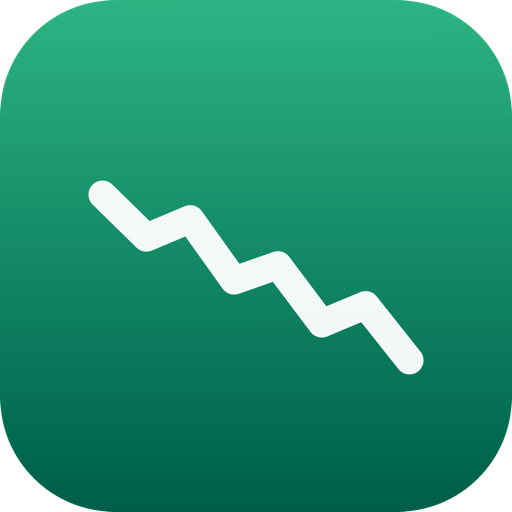

# Stock Peek

A lightweight macOS menu bar app for tracking stock quotes from Yahoo Finance.



## Features

- Live quotes in the menu bar, refreshed on a configurable interval
- Search and add symbols to your watchlist
- Drag watchlist rows to reorder them
- Auto-sizing popover that adapts to the number of tracked stocks
- Launch at login support
- Native SwiftUI app with no third-party dependencies

## Requirements

- macOS 14 (Sonoma) or later
- Swift 6.0 / Xcode 16 or later (only needed to build from source)

## Install

### From source

```bash
git clone https://github.com/kanharithsok/stock-peek.git
cd stock-peek
./scripts/install.sh
```

`install.sh` builds the app and copies it to `/Applications`.

### Homebrew

```bash
brew tap kanharithsok/tap
brew trust kanharithsok/tap
brew install --cask stock-peek
```

Homebrew 7 requires new third-party taps to be trusted explicitly. To upgrade
later:

```bash
brew upgrade --cask stock-peek
```

## Build and run

```bash
swift build
swift run
```

To build a proper `.app` bundle with an icon and ad-hoc code signature:

```bash
./scripts/build_app.sh
open "dist/Stock Peek.app"
```

To build and install into `/Applications`:

```bash
./scripts/install.sh
```

To create a release zip for a GitHub release:

```bash
./scripts/package_release.sh
```

## Usage

1. Launch the app — a chart icon appears in the menu bar. There is no Dock
   icon or main window; the app lives entirely in the menu bar.
2. Click the icon and search for a ticker symbol (for example `AAPL`) to add it.
3. Drag any row onto another row to reorder the watchlist.
4. Open Settings to change the refresh interval or enable launch at login.

## Troubleshooting

If macOS blocks the app, or clicking **Open Anyway** appears to do nothing,
clear the quarantine flag and any stuck launch process:

```bash
pkill -9 -f '/Applications/Stock Peek.app/Contents/MacOS/StockPeek'
xattr -dr com.apple.quarantine "/Applications/Stock Peek.app"
open "/Applications/Stock Peek.app"
```

Then look for the chart icon in the menu bar. If the launch process was stuck
at startup, a reboot also clears it.

## Project structure

```
Sources/StockPeek/
├── App.swift            # App entry point and menu bar scene
├── LegacyMigration.swift # Preferences migration from MacStockWidget
├── MenuBarView.swift    # Menu bar popover UI
├── Models.swift         # Quote models
├── Settings.swift       # Settings and launch-at-login
├── Store.swift          # Watchlist and refresh logic
└── YahooClient.swift    # Yahoo Finance API client

Resources/               # Info.plist and app icon
scripts/                 # Build and install scripts
```

## Notes

Quote data comes from Yahoo Finance's unofficial API and may be delayed. This
project is for personal use and is not affiliated with Yahoo.
